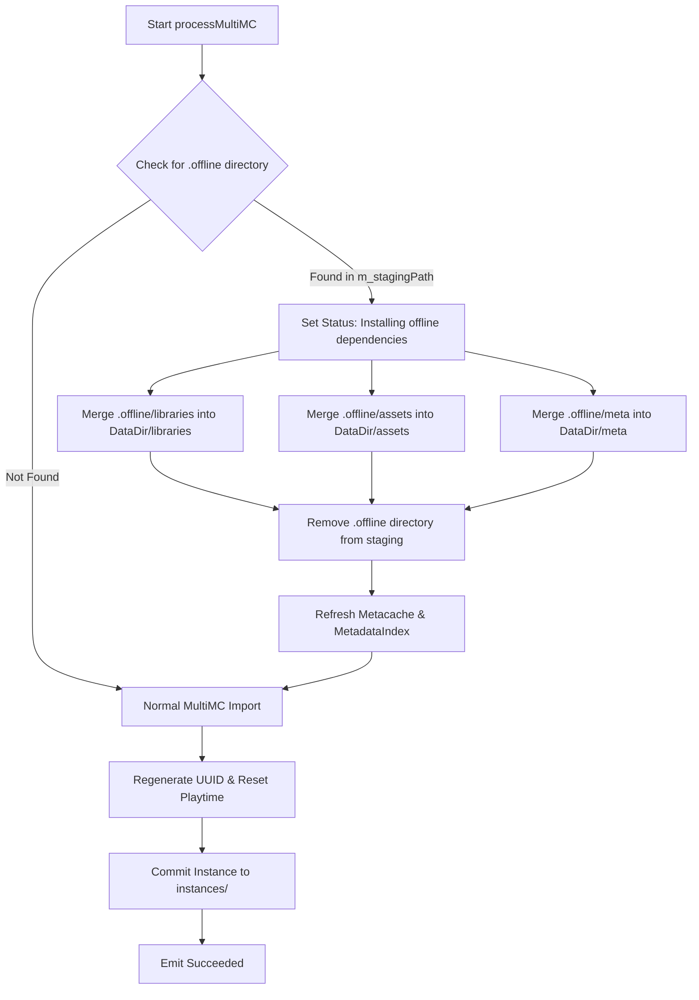

# Fully Offline Instance Export & Import — Implementation Plan

This document details the architectural design and implementation plan for adding **Fully Offline Instance Export & Import** to Freesm Launcher / Prism Launcher.

> [!IMPORTANT]
> **No codebase files have been modified.** This plan contains all necessary discovery details, architecture, file mappings, UI mockups, and step-by-step verification procedures.

---

## 1. Feature Overview & Goals

### The Problem
When a user exports a Prism Launcher / MultiMC instance as a standard `.zip` file, the exported archive only includes the instance folder (`instance.cfg`, `mmc-pack.json`, mods, config, saves, etc.). It does **not** include:
1. **Component Metadata** (`meta/`): JSON patches defining components, dependencies, tweaks, and runtime arguments.
2. **Libraries** (`libraries/`): Minecraft client JAR, LWJGL binaries, native DLLs/SOs, mod loader libraries (Fabric, Forge, NeoForge, Quilt), and Java agents.
3. **Assets** (`assets/`): Sound effects, music, resource pack assets, language translations, and font objects.

When this `.zip` is imported on an air-gapped PC or a machine without an internet connection, launching fails immediately at `EnsureOfflineLibraries` or `ComponentUpdateTask` due to missing files.

### The Solution
1. **Export UI**: In **Export -> Prism Launcher (zip)** (`ExportInstanceDialog`), add an **"Export as offline-ready bundle"** checkbox.
2. **Dependency Resolution**: When checked, the launcher inspects the instance's `PackProfile` (and `mmc-pack.json`) to determine all required metadata JSONs, library JARs, and asset files.
3. **Self-Contained Bundle Creation**: The launcher packages the instance alongside an isolated `.offline/` directory containing all resolved libraries, assets, and metadata (including `.offline/manifest.json`).
4. **Offline Import**: When `InstanceImportTask` detects the `.offline/` directory in the extracted staging path, it automatically extracts the instance to `instances/<name>` and merges the dependencies directly into the launcher's global data directories (`libraries/`, `assets/`, and `meta/`).

---

## 2. Codebase & Directory Structure Analysis

Based on scans of `E:\Minecraft\Freesm Launcher` (portable launcher installation) and the `FreesmLauncher` source tree:

### Launcher Root Directory Layout
```
<LauncherRoot>/
├── assets/
│   ├── indexes/          # e.g., 1.16.json, 1.19.json, 17.json, legacy.json
│   └── objects/          # Hash-addressed asset files: objects/<xx>/<hash>
├── libraries/            # Maven-structured dependencies: com/, net/, org/, etc.
├── meta/                 # Component metadata index & version patches:
│   ├── index.json        # Master component index
│   ├── net.minecraft/    # index.json + <version>.json (e.g., 1.16.5.json)
│   ├── net.fabricmc.fabric-loader/
│   ├── net.minecraftforge/
│   └── org.lwjgl3/
├── instances/            # Instance folders
└── metacache             # HTTP cache metadata
```

### Component & File Dependencies by Instance Type

| Instance Component | Source Location in Launcher | Where Defined in Instance | Notes |
| :--- | :--- | :--- | :--- |
| **Instance Config & Pack** | `<instanceRoot>/instance.cfg`, `mmc-pack.json` | Instance root | Core configuration and component list. |
| **Custom Patches** | `<instanceRoot>/patches/*.json` | `patches/` folder | Exported automatically in standard export. |
| **Component Metadata** | `<LauncherRoot>/meta/<uid>/<version>.json`, `<uid>/index.json` | `mmc-pack.json` components | Required by `ComponentUpdateTask` to load offline. |
| **Minecraft Client JAR** | `<LauncherRoot>/libraries/net/minecraft/minecraft/<ver>/...jar` | `net.minecraft` version patch | Main executable JAR. |
| **Classpath Libraries** | `<LauncherRoot>/libraries/<maven-path>.jar` | `libraries` array in component patches | Required by `EnsureOfflineLibraries` and launch classpath. |
| **Native Libraries** | `<LauncherRoot>/libraries/<maven-path>-natives-<os>.jar` | `nativeClassifiers` in component patches | Extracted to `natives/` during launch. |
| **Asset Index** | `<LauncherRoot>/assets/indexes/<assetIndex.id>.json` | `assetIndex` in `net.minecraft/<ver>.json` | Lists all audio, texture, and text asset hashes. |
| **Asset Objects** | `<LauncherRoot>/assets/objects/<first2>/<hash>` | Referenced in `assets/indexes/<id>.json` | Game sounds, music, icons, fonts (~300–400 MB). |

---

## 3. Archive Layout Specification (.offline Bundle)

To maintain 100% backwards compatibility and avoid namespace collisions inside the instance folder, offline dependencies will be quarantined within a dedicated `.offline/` folder in the root of the `.zip`.

```
<Exported-Offline-Pack.zip>/
├── instance.cfg                         # Standard instance config
├── mmc-pack.json                        # Standard component list
├── patches/                             # Instance-specific component patches
│   └── *.json
├── minecraft/                           # Game files (mods, config, saves, resourcepacks)
│   ├── config/
│   ├── mods/
│   └── ...
└── .offline/                            # Offline dependencies container & bundle indicator
    ├── manifest.json                    # Bundle manifest (component list, counts, hashes)
    ├── meta/                            # Component metadata
    │   ├── index.json
    │   ├── net.minecraft/
    │   │   ├── index.json
    │   │   └── 1.16.5.json
    │   ├── net.fabricmc.fabric-loader/
    │   │   ├── index.json
    │   │   └── 0.18.4.json
    │   └── ...
    ├── libraries/                       # Classpath, native, and client JARs
    │   ├── com/...
    │   ├── net/...
    │   └── org/...
    └── assets/                          # Game assets
        ├── indexes/
        │   └── 1.16.json
        └── objects/
            ├── 00/
            │   └── 002f...
            └── ...
```

### Manifest Format (`.offline/manifest.json`)
```json
{
    "formatVersion": 1,
    "createdAt": "2026-11-14T23:30:00Z",
    "launcherVersion": "FreesmLauncher 1.0.0",
    "instanceName": "1.16.5 [Fabric]",
    "components": [
        { "uid": "net.minecraft", "version": "1.16.5" },
        { "uid": "net.fabricmc.fabric-loader", "version": "0.18.4" },
        { "uid": "org.lwjgl3", "version": "3.2.2" }
    ],
    "assetIndex": "1.16",
    "stats": {
        "librariesCount": 48,
        "assetsCount": 2743,
        "metaCount": 7,
        "totalUncompressedSize": 412589020
    }
}
```

---

## 4. Export Implementation Plan

### 4.1 UI Modifications (`ExportInstanceDialog`)

1. **`ExportInstanceDialog.ui`**:
   - Add a `QGroupBox` below `treeView` titled `"Offline Export Options"`.
   - Add a `QCheckBox` named `exportOfflineCheckBox`:
     - Text: `tr("Export as fully offline bundle (include libraries, assets, and metadata)")`
   - Add a summary label `offlineInfoLabel` displaying:
     - Estimated size (e.g., `tr("Includes ~340 MB of assets, ~65 MB of libraries, and component metadata.")`).
   - Add an optional expandable details button/widget displaying:
     - `[x] Include Libraries`
     - `[x] Include Game Assets`
     - `[x] Include Component Metadata`

2. **`ExportInstanceDialog.cpp`**:
   - In constructor: connect `exportOfflineCheckBox` toggled signal to a method `updateOfflineStats()`.
   - In `updateOfflineStats()`: asynchronously invoke `OfflineDependencyCollector` to compute total files and size.
   - In `doExport()`:
     - If `exportOfflineCheckBox->isChecked()`:
       1. Run dependency validation.
       2. If files are missing locally: prompt user with option to download them now (`mcInstance->createUpdateTask()`).
       3. Pass the resolved offline file mappings to `ExportToZipTask`.

### 4.2 Dependency Resolution Engine (`OfflineDependencyCollector`)

Create a helper class `OfflineDependencyCollector` in `launcher/minecraft/`:

```cpp
struct OfflineFileEntry {
    QString diskPath;       // Absolute path on user's disk
    QString archivePath;    // Destination path inside ZIP (e.g., ".offline/libraries/...")
    qint64 size;
};

class OfflineDependencyCollector {
public:
    explicit OfflineDependencyCollector(MinecraftInstance* instance);
    
    bool collect(QList<OfflineFileEntry>& outFiles, QStringList& outMissingFiles);

private:
    void collectMetadata(QList<OfflineFileEntry>& outFiles, QStringList& outMissing);
    void collectLibraries(QList<OfflineFileEntry>& outFiles, QStringList& outMissing);
    void collectAssets(QList<OfflineFileEntry>& outFiles, QStringList& outMissing);

    MinecraftInstance* m_instance;
};
```

#### Detailed Collection Logic:
1. **Metadata Collection**:
   - Iterate over `m_instance->getPackProfile()->components()`.
   - For each component:
     - Local version file: `meta/<uid>/<version>.json` -> mapped to `.offline/meta/<uid>/<version>.json`.
     - Component index: `meta/<uid>/index.json` -> mapped to `.offline/meta/<uid>/index.json`.
   - Master index: `meta/index.json` -> mapped to `.offline/meta/index.json`.

2. **Library Collection**:
   - Access `LaunchProfile* profile = m_instance->getPackProfile()->getProfile()`.
   - Gather libraries from:
     - `profile->getLibraries()`
     - `profile->getNativeLibraries()`
     - `profile->getMavenFiles()`
     - `profile->getAgents()`
     - `profile->getMainJar()` (the Minecraft client JAR)
   - For each `LibraryPtr lib`:
     - Classpath jars: compute `storageSuffix(runtimeContext)`.
     - Native jars: collect classifiers for the current platform (or all cached classifiers on disk for cross-platform portability).
     - Check file existence at `libraries/<storageSuffix>`. If present, add to `outFiles`. If absent, add to `outMissing`.

3. **Asset Collection**:
   - Fetch asset index info from `profile->getMinecraftAssets()`.
   - Index file: `assets/indexes/<id>.json` -> mapped to `.offline/assets/indexes/<id>.json`.
   - Parse `assets/indexes/<id>.json` via `AssetsUtils::loadAssetsIndexJson()`.
   - For each object in `index.objects`:
     - Path: `assets/objects/<hash.left(2)>/<hash>` -> mapped to `.offline/assets/objects/<hash.left(2)>/<hash>`.
     - Verify on disk. Add to `outFiles` or `outMissing`.

### 4.3 Export Task Execution (`ExportToZipTask`)

Extend `MMCZip::ExportToZipTask` to accept an extra file mapping list `QList<OfflineFileEntry>`:
- The task iterates through standard instance files relative to `m_instance->instanceRoot()`.
- The task then writes `.offline/manifest.json`.
- The task iterates through `QList<OfflineFileEntry>` and writes each file from `diskPath` to `archivePath` inside the archive.
- Progress updates are propagated to `ProgressDialog` (`"Compressing offline assets..."`, `"Compressing libraries..."`).

---

## 5. Import Implementation Plan

### 5.1 Import Task Flow (`InstanceImportTask`)

The existing import process works in stages:
1. `processZipPack()`: Analyzes archive contents, identifies type (`MultiMC`), and creates `ExtractZipTask` to unpack to `m_stagingPath`.
2. `extractFinished()`: Fixes file permissions and invokes `processMultiMC()`.
3. `processMultiMC()`: Loads instance settings, regenerates UUID, resets playtime, and commits the instance.

### 5.2 Offline Detection & Installation

In `InstanceImportTask::processMultiMC()`:



#### Step-by-Step Implementation in `processMultiMC()`:
1. **Offline Bundle Detection**:
   - Check if `QDir(FS::PathCombine(m_stagingPath, ".offline")).exists()` is true (or if `FS::PathCombine(m_stagingPath, ".offline/manifest.json")` exists).
2. **Directory Merging**:
   - Use a non-destructive merge helper `mergeDirectory(QString sourceDir, QString targetDir)`:
     ```cpp
     bool mergeDirectory(const QString& sourceDir, const QString& targetDir) {
         QDir source(sourceDir);
         if (!source.exists()) return true;
         
         QDirIterator it(sourceDir, QDir::Files, QDirIterator::Subdirectories);
         while (it.hasNext()) {
             QString srcFilePath = it.next();
             QString relativePath = source.relativeFilePath(srcFilePath);
             QString dstFilePath = FS::PathCombine(targetDir, relativePath);
             
             FS::ensureFilePathExists(dstFilePath);
             // If file already exists and size matches, skip to save disk I/O
             if (QFile::exists(dstFilePath)) {
                 if (QFileInfo(srcFilePath).size() == QFileInfo(dstFilePath).size()) {
                     continue;
                 }
                 QFile::remove(dstFilePath);
             }
             if (!QFile::copy(srcFilePath, dstFilePath)) {
                 qWarning() << "Failed to copy offline file:" << srcFilePath << "to" << dstFilePath;
             }
         }
         return true;
     }
     ```
   - Merge `.offline/libraries` -> `APPLICATION->metacache()->getBasePath("libraries")` (or `QDir("libraries").absolutePath()`).
   - Merge `.offline/assets` -> `QDir("assets").absolutePath()`.
   - Merge `.offline/meta` -> `QDir("meta").absolutePath()`.
3. **Fallback for Root-Level Structure**:
   - If `.offline` exists, but dependencies are located at `m_stagingPath/libraries/` or `m_stagingPath/assets/`:
     - Merge `m_stagingPath/libraries` -> `DataDir/libraries`.
     - Merge `m_stagingPath/assets` -> `DataDir/assets`.
     - Merge `m_stagingPath/meta` -> `DataDir/meta`.
     - Remove those folders from `m_stagingPath` so they do not remain inside the instance folder.
4. **Cleanup**:
   - `FS::deletePath(FS::PathCombine(m_stagingPath, ".offline"));`
5. **Metadata Refresh**:
   - Notify `APPLICATION->metadataIndex()` or reload loaded lists so newly dropped component versions are immediately available to offline checks without restarting the launcher.

---

## 6. How the User Can Test & Verify (Manual Simulation)

Since the user requested instructions on how to test this with a separate folder without altering the main setup:

### Step 1: Create a Clean Test Environment
1. Create a clean test folder: `E:\Minecraft\TestOfflineLauncher`.
2. Copy the launcher binaries from `E:\Minecraft\Freesm Launcher`:
   - `freesmlauncher.exe`
   - All `.dll` files (`Qt6*.dll`, `archive.dll`, `zlib1.dll`, etc.)
   - `portable.txt` (to keep it strictly self-contained)
   - Do **NOT** copy `libraries/`, `assets/`, or `meta/`.

### Step 2: Manually Assemble an Offline `.zip` Pack
To verify the offline import logic manually before code implementation:
1. Pick an instance from `E:\Minecraft\Freesm Launcher\instances\1.16.5 [Fabric]`.
2. Create a temporary folder `ExportTest/`:
   - Copy `1.16.5 [Fabric]/*` into `ExportTest/` (including `instance.cfg`, `mmc-pack.json`, `minecraft/`).
   - Create folder `ExportTest/.offline/`.
   - Copy `E:\Minecraft\Freesm Launcher\meta/net.minecraft/1.16.5.json` and `net.fabricmc.fabric-loader/0.18.4.json` into `ExportTest/.offline/meta/...`.
   - Copy required libraries from `E:\Minecraft\Freesm Launcher\libraries/...` into `ExportTest/.offline/libraries/...`.
   - Copy `E:\Minecraft\Freesm Launcher\assets/indexes/1.16.json` and its objects into `ExportTest/.offline/assets/...`.
3. Compress `ExportTest/` into `1.16.5-Offline.zip`.

### Step 3: Test Import & Launch
1. Disconnect the test PC from the Internet (or disable network adapter).
2. Launch `E:\Minecraft\TestOfflineLauncher\freesmlauncher.exe`.
3. Drag-and-drop `1.16.5-Offline.zip` into the launcher (or use **Add Instance -> Import**).
4. Verify:
   - The instance appears in the instance list.
   - `E:\Minecraft\TestOfflineLauncher\libraries/` contains all libraries.
   - `E:\Minecraft\TestOfflineLauncher\assets/` contains the index and objects.
   - `E:\Minecraft\TestOfflineLauncher\meta/` contains component JSONs.
   - Launching the instance succeeds without network errors.

---

## 7. Files to Create & Modify for Implementation

When ready to implement, the following files will be modified or created:

| File Path | Action | Description |
| :--- | :--- | :--- |
| `launcher/ui/dialogs/ExportInstanceDialog.ui` | Modify | Add `exportOfflineCheckBox` and statistics labels. |
| `launcher/ui/dialogs/ExportInstanceDialog.h` | Modify | Add member variables and slots for offline export. |
| `launcher/ui/dialogs/ExportInstanceDialog.cpp` | Modify | Integrate offline file collection and missing file prompt in `doExport()`. |
| `launcher/minecraft/OfflineDependencyCollector.h` | **Create** | Header for dependency collection helper. |
| `launcher/minecraft/OfflineDependencyCollector.cpp` | **Create** | Logic to resolve metadata, libraries, and asset objects from `LaunchProfile`. |
| `launcher/archive/ExportToZipTask.h` | Modify | Support external file mappings with custom destination paths. |
| `launcher/archive/ExportToZipTask.cpp` | Modify | Write mapped offline dependency files and `.offline/manifest.json` to archive. |
| `launcher/InstanceImportTask.cpp` | Modify | Add detection of `.offline/` directory, merge dependencies into launcher data dirs, and clean staging. |
| `launcher/CMakeLists.txt` | Modify | Add `OfflineDependencyCollector.cpp` and `OfflineDependencyCollector.h`. |

---

## 8. Summary of Benefits & Architecture Strengths

1. **Strict Isolation**: Isolating dependencies inside `.offline/` prevents polluting the instance root folder with non-instance files.
2. **True Air-Gapped Portability**: Includes metadata, libraries, and assets—all three legs of the stool required for Minecraft to boot without internet.
3. **Deduplication on Import**: Asset objects and libraries with identical file sizes/hashes are not rewritten, saving disk writes and speeding up imports.
4. **Resilience**: Even if an offline pack is imported into an unmodified Prism/MultiMC launcher, the instance imports normally (with dependencies ignored or downloaded via internet). In Freesm Launcher, it installs completely offline.
